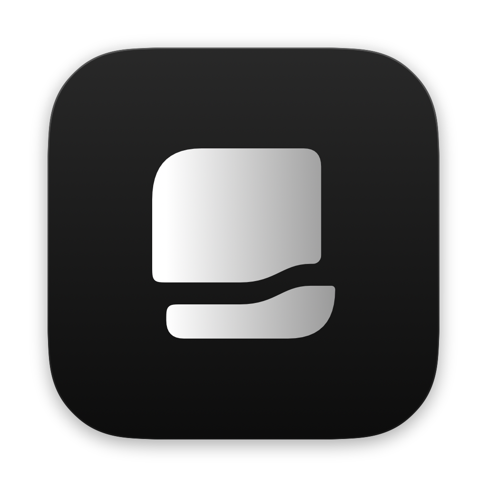

<p align="center"></p>

<h1 align="center">Ebbrim</h1>

<p align="center">Your Claude and Codex plan limits, live, at the edge of your Mac's screen.</p>

Ebbrim is a small macOS app that sits on the side or bottom of your screen
and shows how much of your 5-hour session and your weekly limit you have used
in Claude and in Codex, and how fast you are using it. It also lists the
local dev servers you have running.

It needs no login, no token and no password, and it never goes online itself.

## Install

<p align="center">
  <a href="https://github.com/S1edur/Ebbrim/releases/latest/download/Ebbrim.dmg"></a>
</p>

Needs a Mac with Apple silicon and **macOS 26 or later**.

1. Download **Ebbrim.dmg** with the button above.
2. Open it and drag **Ebbrim** onto **Applications**.
3. Open Ebbrim from Applications. The first time, macOS says it can't verify
   the developer, because Ebbrim isn't notarized by Apple yet. Click **Done**,
   then open **System Settings › Privacy & Security**, scroll down and click
   **Open Anyway** next to Ebbrim. You only do this once.

   Prefer the terminal? This does the same:

   ```bash
   xattr -dr com.apple.quarantine /Applications/Ebbrim.app && open /Applications/Ebbrim.app
   ```

4. A short tour opens. Press **Connect** next to Claude and Codex: nothing is
   read until you do.

### Or build it yourself (no warning)

If you have Apple's free Command Line Tools (the installer offers to add
them), this downloads the source into `~/.ebbrim`, builds Ebbrim on your Mac in
about a minute, and starts it. Built on your own Mac, so macOS shows no warning.

```bash
curl -fsSL https://raw.githubusercontent.com/S1edur/Ebbrim/main/install.sh | bash
```

Or clone first and read the code:

```bash
git clone https://github.com/S1edur/Ebbrim.git
cd Ebbrim
./install.sh
```

## Update

Downloaded the DMG: download the new one and drag it onto Applications again.
Built it yourself: run the install command again. Your settings are kept.

## Uninstall

From the menu-bar icon or Settings: **Uninstall Ebbrim…**. Or, if you built it yourself:

```bash
bash ~/.ebbrim/uninstall.sh
```

Both put back your previous Claude Code status line (if you had connected
it), remove the login item, Ebbrim's preferences and data folder, the app, and
the downloaded source in `~/.ebbrim` (if you built it yourself). Claude, Codex and your logins are not
touched.

## What it reads

| Source | How | Set-up |
|---|---|---|
| **Claude** | The usage record Claude Desktop already keeps in its own cache on your Mac (`~/Library/Application Support/Claude/Cache`). Only that one record is read. Desktop refreshes it about every 2 minutes while you use it. | None, if you use Claude Desktop |
| **Codex** | Asks the helper that ships inside the Codex app (`codex app-server`) for your rate limits. Codex contacts OpenAI with its own login; Ebbrim never sees it. | None, if Codex is installed |
| **Claude Code in Terminal** (optional) | A status line command that saves the limits Claude Code already prints. Ebbrim adds it to `~/.claude/settings.json` only when you click **Connect**, keeps your own status line working, and restores it on **Disconnect**. | One click |
| **Local servers** | Lists processes listening on local ports. | None, can be turned off |

Ebbrim keeps no token, no Keychain item and no password. It has no network
code. Everything it stores stays in `~/Library/Application Support/Ebbrim` and
its preferences.

**Plans.** Codex reports your plan. Claude's usage record does not, so Ebbrim
labels a Claude account **Max 20x** when it has only a weekly limit, and shows
no plan badge otherwise.

## Limits

- Claude numbers come from Claude Desktop, so they update when Desktop does.
  When Desktop is closed for a while, Ebbrim shows how old the numbers are
  instead of pretending they are live.
- Ebbrim reads formats that Claude Desktop and Codex do not document. If an
  update changes them, Ebbrim says the data is unavailable rather than showing
  a wrong number.
- Ebbrim isn't notarized by Apple yet, so the downloaded app needs **Open
  Anyway** once. Building it yourself avoids that.

## Develop

```bash
Ebbrim/test.sh                                              # data-layer tests
Ebbrim/build.sh                                             # builds build.noindex/Ebbrim.app
EBBRIM_MOCK=1 build.noindex/Ebbrim.app/Contents/MacOS/Ebbrim                  # UI with sample data
EBBRIM_MOCK=1 EBBRIM_MOCK_CLAUDE=20x build.noindex/Ebbrim.app/Contents/MacOS/Ebbrim   # a Max 20x account
./reset-first-run.sh                                        # see the first-run tour again
```

The UI reads one observable object, `UsageFeed` (`Ebbrim/Sources/UsageFeed.swift`),
which is the contract between the data layer (`Ebbrim/Sources/Data/`) and the
views. `Ebbrim/package.sh` builds `Ebbrim.dmg` for a release.

Issues and pull requests are welcome.

## License

[MIT](LICENSE) © 2026 Denys Rudenko. Third-party code and art: see
[THIRD_PARTY_NOTICES.md](THIRD_PARTY_NOTICES.md).
